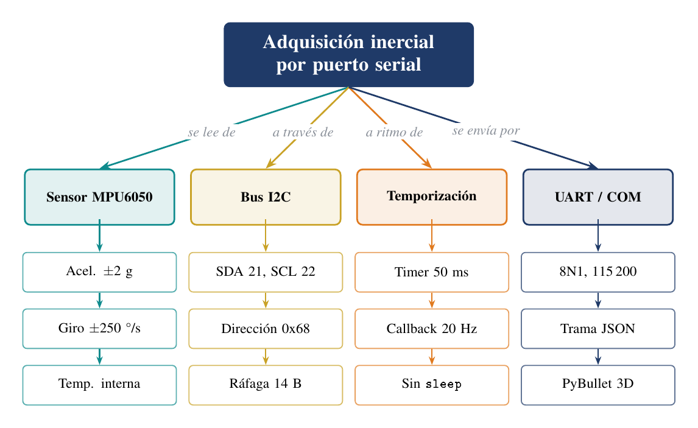
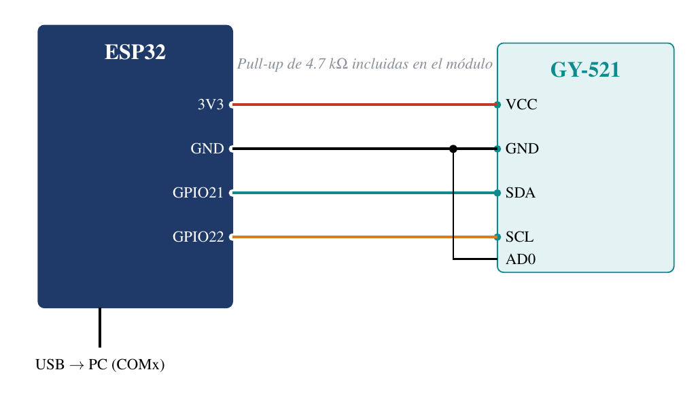
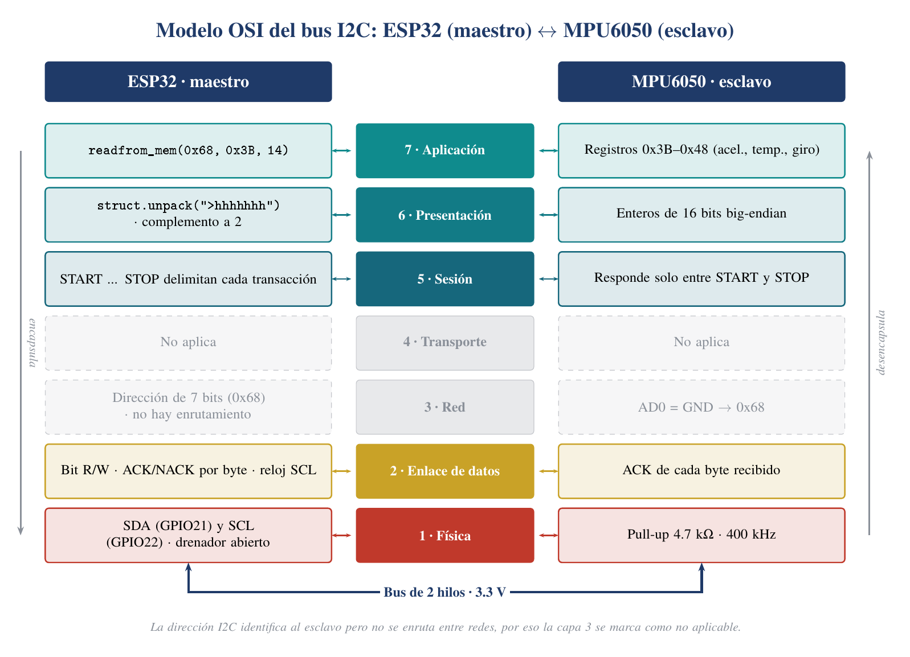
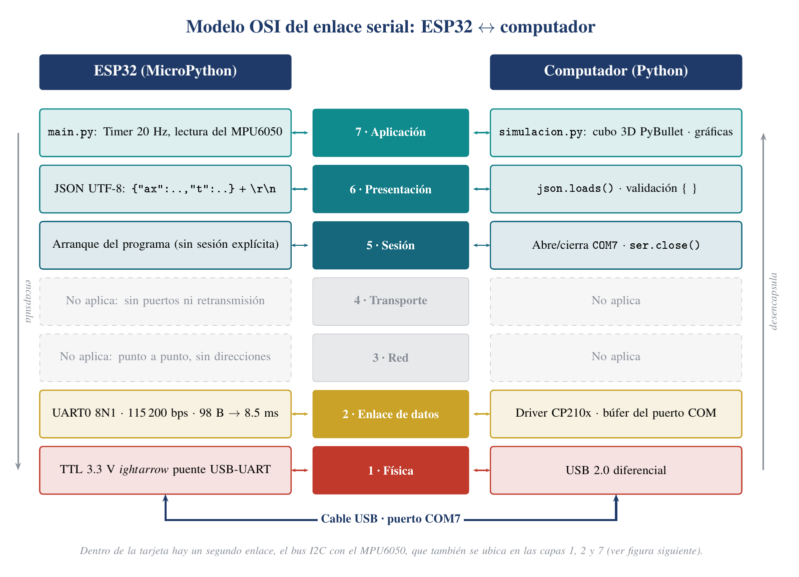
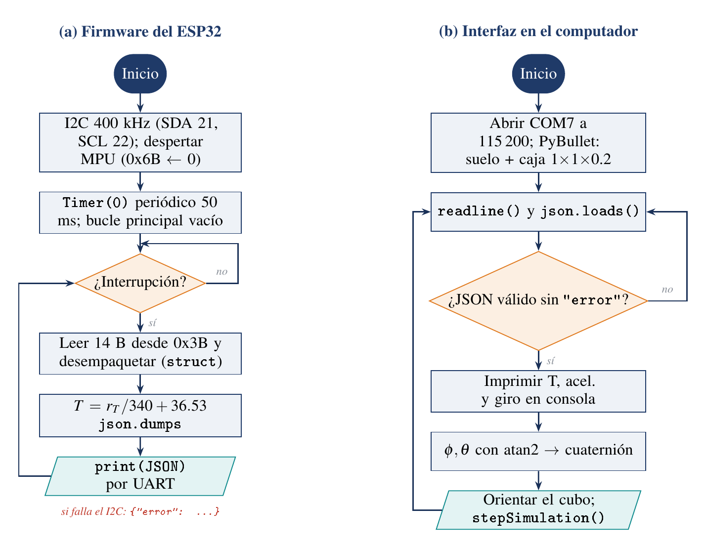
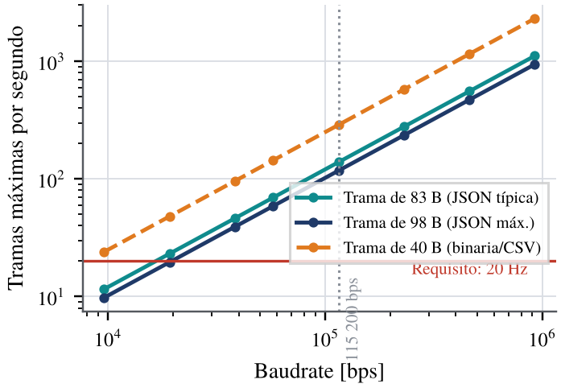
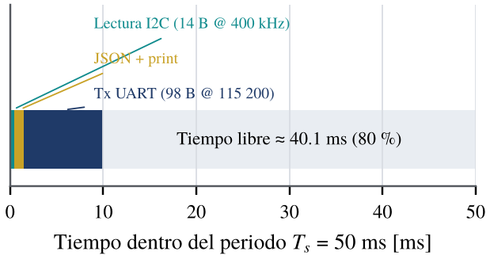
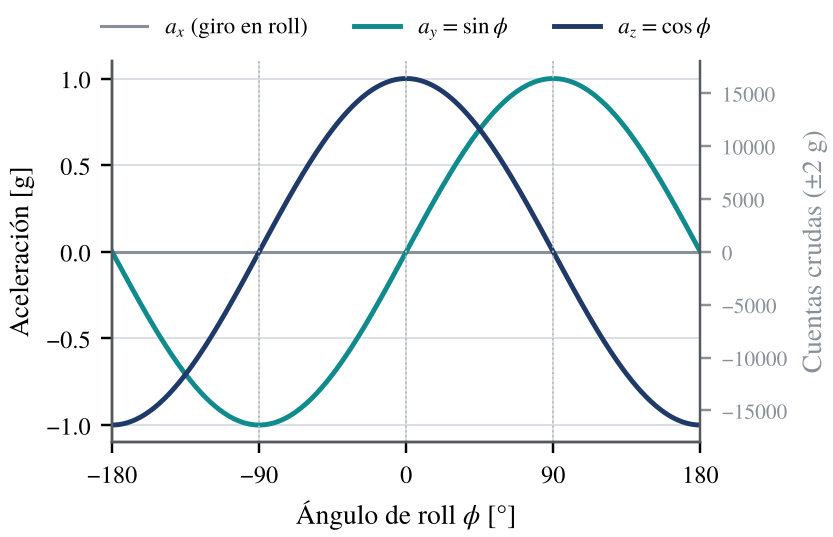

<p align="center"></p>

<p align="center">


</p>

<p align="center"><b>Leer un sensor inercial 20 veces por segundo, enviarlo por el puerto COM<br>y ver su orientación en 3D en tiempo real.</b></p>

---

## 📑 Contenido

1. [Descripción y objetivos](#-1-descripción-y-objetivos)
2. [Ficha técnica](#-2-ficha-técnica)
3. [Arquitectura del sistema](#-3-arquitectura-del-sistema)
4. [Hardware y conexiones](#-4-hardware-y-conexiones)
5. [Modelo OSI de las comunicaciones](#-5-modelo-osi-de-las-comunicaciones)
6. [Del sensor al computador](#-6-del-sensor-al-computador)
7. [Funcionamiento paso a paso](#%EF%B8%8F-7-funcionamiento-paso-a-paso)
8. [Ecuaciones](#-8-ecuaciones)
9. [Resultados y análisis](#-9-resultados-y-análisis)
10. [Hallazgos y mejoras](#-10-hallazgos-y-mejoras)
11. [Estructura y uso](#-11-estructura-y-uso)
12. [Informe](#-12-informe)

---

## 🎯 1. Descripción y objetivos

El **MPU6050** combina un acelerómetro y un giroscopio de tres ejes con un sensor de temperatura. El **ESP32** lo lee por **I2C** cada **50 ms** gracias a un **temporizador por hardware**, empaqueta las siete variables en una línea **JSON** y las envía por la **UART** al computador, que la recibe como un **puerto COM**.

En el computador, un programa en Python decodifica cada línea, calcula los ángulos de **alabeo** y **cabeceo** a partir de la gravedad y orienta un **cubo 3D en PyBullet** que imita al sensor real. Un segundo script grafica las señales en el tiempo.

**Objetivos**
- Transmitir de forma continua y estructurada aceleración, velocidad angular y temperatura por el puerto serial.
- Garantizar una frecuencia mínima de **20 Hz** usando interrupciones, sin retardos bloqueantes.
- Visualizar en tiempo real las señales y la orientación tridimensional del sensor.

## 🧾 2. Ficha técnica

| Parámetro | Valor |
|---|---|
| Microcontrolador | ESP32 (MicroPython) |
| Sensor | MPU6050 (GY-521) · ±2 g · ±250 °/s · dirección `0x68` |
| Bus del sensor | I2C 400 kHz (SDA 21, SCL 22) · ráfaga de 14 B ≈ 0.39 ms |
| Temporización | `Timer(0)` periódico de 50 ms → **20 Hz** |
| Enlace al PC | UART0 · 115 200 bps · 8N1 · puerto COM7 |
| Trama | JSON de 83–98 B por línea |
| Visualización | PyBullet (cubo 3D) · Matplotlib (curvas X, Y, Z, T) |

## 🧩 3. Arquitectura del sistema

<p align="center"></p>

El temporizador marca el ritmo; en cada interrupción el ESP32 lee el sensor, arma el JSON y lo imprime por la UART. El puente USB-UART de la tarjeta lo convierte en un puerto COM que Python lee línea por línea.

<p align="center"><br><sub>Mapa conceptual de la práctica</sub></p>

## 🔌 4. Hardware y conexiones

| MPU6050 (GY-521) | ESP32 | Función |
|---|:-:|---|
| VCC / GND | 3V3 / GND | Alimentación |
| SDA | **GPIO21** | Datos I2C (bidireccional) |
| SCL | **GPIO22** | Reloj I2C · 400 kHz |
| AD0 | GND | Dirección `0x68` |
| — | USB | UART0 hacia el computador |

<p align="center"><br><sub>El módulo GY-521 ya trae las resistencias de pull-up de 4.7 kΩ</sub></p>

## 🌐 5. Modelo OSI de las comunicaciones

La práctica tiene **dos enlaces en cadena**, y ninguno de los dos es una red: ambos son **punto a punto**, por eso las capas de **red (3)** y **transporte (4)** no aplican. No hay direcciones IP que enrutar ni puertos lógicos; el "puerto COM" es solo el nombre del dispositivo en Windows.

**a) Bus I2C (ESP32 ↔ MPU6050).** La capa física son los dos hilos SDA/SCL; la de enlace, la dirección de 7 bits, el bit R/W y los ACK; las capas superiores son los registros del sensor y su formato de 16 bits.

<p align="center"></p>

**b) UART (ESP32 ↔ computador).** El JSON (capa 6) viaja en tramas 8N1 (capa 2) sobre USB (capa 1) y lo consume la interfaz 3D (capa 7).

<p align="center"></p>

| Capa | Bus I2C | UART / COM |
|---|---|---|
| 7 · Aplicación | Lectura de registros 0x3B–0x48 | `simulacion.py` · cubo 3D |
| 6 · Presentación | Enteros de 16 bits con signo | JSON en UTF-8 |
| 5 · Sesión | START … STOP | Abrir/cerrar `COM7` |
| 4 · Transporte | — | — |
| 3 · Red | — (dirección 0x68 no enrutable) | — |
| 2 · Enlace | R/W, ACK/NACK, reloj | Trama 8N1 · 115 200 bps |
| 1 · Física | SDA/SCL, drenador abierto | TTL 3.3 V → USB |

## 📡 6. Del sensor al computador

<p align="center"><br><sub>Lectura I2C en ráfaga: el ESP32 pide 14 bytes a partir del registro 0x3B</sub></p>
<p align="center"><br><sub>Cada carácter del JSON viaja en 10 bits: inicio + 8 datos + parada</sub></p>

**Trama JSON** (una por línea; si falla el I2C se envía `{"error": "..."}`):
```json
{"ax": -512, "ay": 230, "az": 16120, "t": 24.56, "gx": -130, "gy": 45, "gz": -12}
```

## ⚙️ 7. Funcionamiento paso a paso

1. ⏱️ Al arrancar, el ESP32 despierta el MPU6050 (registro `0x6B ← 0`) y programa `Timer(0)` cada 50 ms.
2. 📥 En cada interrupción lee 14 bytes desde `0x3B` y los separa con `struct.unpack('>hhhhhhh')`.
3. 🌡️ Convierte la temperatura con $T = r_T/340 + 36.53$ y arma el diccionario.
4. 📤 `print(json.dumps(...))` lo envía por la UART; el bucle principal queda libre.
5. 💻 En el PC, `simulacion.py` lee cada línea, descarta las incompletas y hace `json.loads()`.
6. 📐 Calcula $\phi$ y $\theta$ con la gravedad, los convierte en cuaternión y orienta el cubo en PyBullet.
7. 📈 Opcional: `graficas_tiempo_real.py` dibuja las curvas y muestra la frecuencia real medida.

<p align="center"></p>

## 📐 8. Ecuaciones

| Ecuación | Para qué sirve |
|---|---|
| $r = 256H + L$, si $r>32767$: $r-65536$ | Reconstruir cada eje (complemento a 2) |
| $a = r_a/16384$ [g] · $\omega = r_g/131$ [°/s] · $T = r_T/340+36.53$ [°C] | Pasar de cuentas a unidades físicas |
| $\phi=\text{atan2}(a_y,a_z)$ · $\theta=\text{atan2}(-a_x,\sqrt{a_y^2+a_z^2})$ | Orientación respecto a la gravedad |
| $T_{trama}=10B/\text{baud}$ · $f_{max}=\text{baud}/10B$ | Capacidad del enlace serial |
| $\hat\phi_k=\alpha(\hat\phi_{k-1}+\omega\Delta t)+(1-\alpha)\phi_{acc}$ | Filtro complementario (mejora) |

**Cálculo del enlace:** trama de 98 B a 115 200 bps → $T = 8.51$ ms, $f_{max} = 117.6$ Hz → a 20 Hz se ocupa el **17 %** del canal.

## 📊 9. Resultados y análisis

| Tramas máximas vs. baudrate | Presupuesto de un ciclo de 50 ms |
|:-:|:-:|
|  |  |
| Con **9600** o **19 200 bps** el JSON no alcanza los 20 Hz; con 115 200 bps sobra margen. | I2C + JSON + UART ocupan ≈ 10 ms: queda libre el **80 %** del periodo. |
| **Gravedad vs. ángulo de alabeo** | **Filtro complementario** |
|  |  |
| Referencia para validar que X, Y, Z están bien asignados en la interfaz. | Combina acelerómetro (lento) y giroscopio (rápido) con $f_c$ = 0.065 Hz. |

| Posición del sensor | $a_x$ | $a_y$ | $a_z$ | Ángulo esperado |
|---|:-:|:-:|:-:|:-:|
| Plano | 0 | 0 | +1 g | $\phi=\theta=0°$ |
| Roll +90° | 0 | +1 g | 0 | $\phi=+90°$ |
| Invertido | 0 | 0 | −1 g | $\phi=180°$ |
| Pitch +90° | −1 g | 0 | 0 | $\theta=+90°$ |

## 💡 10. Hallazgos y mejoras

| Observación | Propuesta |
|---|---|
| El JSON es legible pero pesado (hasta 98 B) | Trama binaria con cabecera: cabría incluso a 9600 bps |
| Con movimientos bruscos el cubo "tiembla" | Filtro complementario o de Kalman |
| No se detectan tramas perdidas | Contador de secuencia y checksum en cada línea |
| Offsets del giroscopio en reposo | Calibración inicial con 200 muestras |
| El yaw no se puede obtener de la gravedad | Agregar un magnetómetro |

## 📁 11. Estructura y uso

```text
├── firmware/main.py              ← ESP32: Timer 50 ms → I2C → JSON → print
├── pc/
│   ├── simulacion.py             ← modelo 3D en PyBullet + valores en consola
│   ├── graficas_tiempo_real.py   ← curvas de aceleración, giro y temperatura
│   └── requirements.txt
└── docs/                         ← informe IEEE (PDF) e imágenes
```

1. Copiar `firmware/main.py` al ESP32 y **cerrar Thonny** (libera el puerto COM).
2. Instalar dependencias: `pip install -r pc/requirements.txt`
3. Modelo 3D: `python pc/simulacion.py` · Gráficas: `python pc/graficas_tiempo_real.py COM7`

## 📄 12. Informe

📘 [**Informe IEEE completo (PDF)**](docs/Informe_Lab3_Puertos_Seriales.pdf) — marco teórico, cálculos del enlace, validación y respuestas a las preguntas de discusión.

---
<p align="center"><b>Universidad Militar Nueva Granada</b> · Ingeniería en Mecatrónica · Laboratorio de Micros · 2026<br>
Nicolas Santiago Pulido Buitrago (7004630) · Bryan Andrey Martínez Montaño (7004588)</p>
