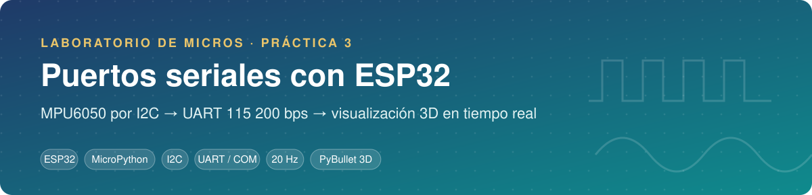
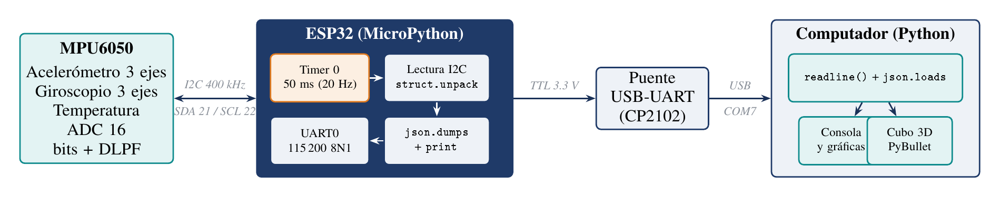
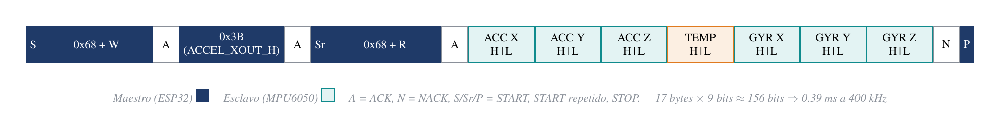
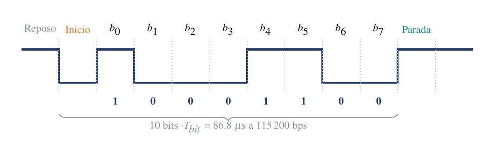
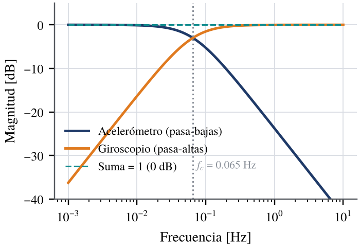

<p align="center"></p>

<p align="center">


</p>

> El **ESP32** lee el **MPU6050** por **I2C** cada **50 ms** (temporizador por hardware → **20 Hz**), envía cada muestra como **JSON** por el **puerto COM** y el computador orienta un **modelo 3D** del sensor en tiempo real y grafica sus señales.

## 🧩 Arquitectura

<p align="center"></p>

<p align="center"> <br><sub>Mapa conceptual · Conexiones ESP32–MPU6050</sub></p>

## 🔌 Conexiones

| MPU6050 (GY-521) | ESP32 | Función |
|---|:-:|---|
| VCC / GND | 3V3 / GND | Alimentación |
| SDA | **GPIO21** | Datos I2C |
| SCL | **GPIO22** | Reloj I2C · 400 kHz |
| AD0 | GND | Dirección `0x68` |
| — | USB | UART0 · 115 200 bps · 8N1 |

## 📡 Del sensor al computador

<p align="center"><br><sub>Lectura I2C en ráfaga de los registros 0x3B–0x48 (14 B ≈ 0.39 ms)</sub></p>
<p align="center"><br><sub>Trama UART 8N1: 10 bits por carácter</sub></p>

**Trama JSON (una por línea, 83–98 B):**
```json
{"ax": -512, "ay": 230, "az": 16120, "t": 24.56, "gx": -130, "gy": 45, "gz": -12}
```

| Ecuación | Uso |
|---|---|
| $a = r_a/16384$ [g] · $\omega = r_g/131$ [°/s] · $T = r_T/340+36.53$ [°C] | Conversión (±2 g, ±250 °/s) |
| $\phi=\text{atan2}(a_y,a_z)$ · $\theta=\text{atan2}(-a_x,\sqrt{a_y^2+a_z^2})$ | Orientación respecto a la gravedad |
| $T_{trama}=10B/\text{baud}$ · $f_{max}=\text{baud}/10B$ | Capacidad del enlace |

## 🔁 Programas

<p align="center"></p>

## 📊 Análisis

| Tramas máximas vs. baudrate | Presupuesto de un ciclo de 50 ms |
|:-:|:-:|
|  |  |
| **Gravedad vs. ángulo (validación de ejes)** | **Filtro complementario (mejora)** |
|  |  |

> [!IMPORTANT]
> A **115 200 bps** la trama JSON ocupa **8.51 ms** (17 % del canal) y el ciclo deja libre el **80 %** de los 50 ms. Con **9600** o **19 200 bps** no se alcanzarían los 20 Hz.

## 📁 Estructura

```text
├── firmware/main.py              ← ESP32: Timer 50 ms → I2C → JSON → print
├── pc/
│   ├── simulacion.py             ← modelo 3D en PyBullet + valores en consola
│   ├── graficas_tiempo_real.py   ← curvas de aceleración, giro y temperatura
│   └── requirements.txt
└── docs/                         ← informe IEEE (PDF) e imágenes
```

## ▶️ Uso rápido

1. Copiar `firmware/main.py` al ESP32 y **cerrar Thonny** (libera el puerto COM).
2. `pip install -r pc/requirements.txt`
3. Modelo 3D: `python pc/simulacion.py` · Gráficas: `python pc/graficas_tiempo_real.py COM7`

## 📄 Informe

📘 [**Informe IEEE completo (PDF)**](docs/Informe_Lab3_Puertos_Seriales.pdf)

---
<p align="center"><b>Universidad Militar Nueva Granada</b> · Ingeniería en Mecatrónica · Laboratorio de Micros · 2026<br>
Nicolas Santiago Pulido Buitrago · Bryan Andrey Martínez Montaño</p>
